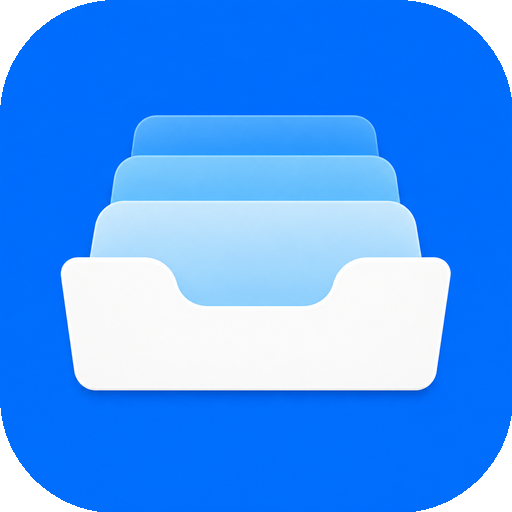
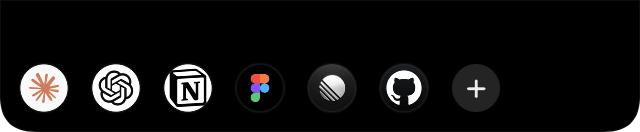
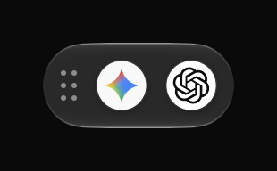

**Languages:** English | [简体中文](README.zh-CN.md)

<p align="center">
  
</p>

<h1 align="center">NeatWebApp</h1>

<p align="center">
  <strong>Turn websites into focused macOS apps, launched from the notch.</strong>
</p>

<p align="center">
  <a href="https://github.com/NeatMacApps/NeatWebApp/releases/latest"></a>
  <a href="LICENSE"></a>
  
</p>

Browser tabs bury your everyday tools. Safari's **Add to Dock** is convenient, but each saved web app adds another icon to your Dock.

**NeatWebApp** gives your sites a separate notch launcher and lets mostly hidden windows tuck themselves into a floating glass activity Dock. Every app has its own website data, so separate instances can keep work and personal accounts apart.

<table align="center">
  <tr>
    <td align="center">
      <br>
      <sub><b>Notch launcher</b> · your sites, one hover away</sub>
    </td>
    <td align="center">
      <br>
      <sub><b>Activity Dock</b> · collapsed sites stay within reach</sub>
    </td>
  </tr>
</table>

## Why NeatWebApp?

| Feature | What it does |
| :--- | :--- |
| **Notch launcher** | Hover the MacBook notch—or the top-center hot zone on other displays—to reveal your sites. The launcher lives outside the system Dock; no account or cloud sync is required. |
| **Edge-tucking activity Dock** | Drag a window mostly off-screen and it tucks into the floating glass activity Dock. Click its icon to bring the same window back; right-click to quit that web app. |
| **Separate website data** | Each app instance has a persistent, isolated WebKit data store for cookies and website storage. Zoom and bookmarks are also saved per app instance. |
| **Per-site element hiding** | Hide distracting banners, sidebars, or navigation elements on individual websites without changing other apps. |
| **Create an app from a bookmark** | Right-click an in-app bookmark and choose **Add WebApp**. The new app gets its own data store and a one-time copy of the current app's cookies. |
| **Native WebKit essentials** | Clean WebKit windows, Finder download management, file uploads, camera and microphone support, and automatic Sparkle updates. |

Like Safari's web apps, running NeatWebApp sites can use their own site icons in the macOS Dock and ⌘Tab. NeatWebApp's distinction is the separate notch launcher, automatic edge tucking, built-in element hiding, and bookmark-based app creation—not a claim that Safari lacks website-data isolation.

## Install

**Requires macOS 15 or later; Apple silicon and Intel are supported.** Sites and their data stay on your Mac. NeatWebApp has no account, cloud sync, or telemetry service.

### Homebrew

```bash
brew install --cask x0c/tap/neatwebapp
```

### Direct download

Download the latest **signed and notarized** `NeatWebApp-x.y.z.dmg` from [Releases](https://github.com/NeatMacApps/NeatWebApp/releases/latest) and drag **NeatWebApp** to **Applications**.

Automatic updates are built in via [Sparkle](https://sparkle-project.org). You can also choose **Check for Updates…** from the menu bar or **General** settings.

<details>
<summary><strong>Build from source</strong></summary>

Requires Xcode 16.2+ and [XcodeGen](https://github.com/yonaskolb/XcodeGen):

```bash
git clone https://github.com/NeatMacApps/NeatWebApp.git
cd NeatWebApp
xcodegen generate
xcodebuild -project NeatWebApp.xcodeproj -scheme NeatWebApp -configuration Release \
  -destination 'platform=macOS' -derivedDataPath build/DerivedData build
rm -rf /Applications/NeatWebApp.app
ditto build/DerivedData/Build/Products/Release/NeatWebApp.app /Applications/NeatWebApp.app
open /Applications/NeatWebApp.app
```

</details>

## Quick Start

1. **Reveal the launcher:** Move your pointer to the MacBook notch, or to the top-center edge on a display without a notch.
2. **Add a site:** Click **+** in the launcher, then enter a name and URL in **Web Apps**.
3. **Tuck and restore:** Drag a window mostly off-screen to park it in the activity Dock. Click its icon to restore the same window, or right-click to quit that web app.
4. **Create a separate instance:** Open **Bookmarks** from a window's **More Actions** menu. Right-click a bookmark and choose **Add WebApp** to create another app with a copy of the current cookies.

The bookmark action copies cookies only—not localStorage, IndexedDB, or passkeys. The two apps keep separate data afterward, and some websites may still ask you to sign in.

## More Native macOS & Developer Tools

| Project | Description |
| :--- | :--- |
| **[NeatEditor](https://github.com/NeatMacApps/NeatEditor)** | Fast-launching, distraction-free native plain-text editor with multi-tab autosave. |
| **[NeatPaste](https://github.com/NeatMacApps/NeatPaste)** | Local-first clipboard history in the menu bar, one shortcut away. |
| **[HandySwitch](https://github.com/x0c/HandySwitch)** & **[MacResourceMonitor](https://github.com/x0c/MacResourceMonitor)** | Everyday menu-bar toggles and a one-click CPU process monitor. |
| **[Corral](https://github.com/corral-dev/corral-apple)** | Run Claude Code, Codex, and Cursor side by side, with native Mac and iPhone clients. |

## License

[MIT](LICENSE)
