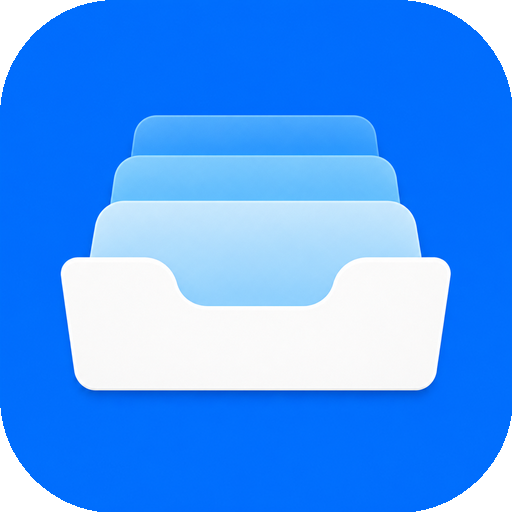
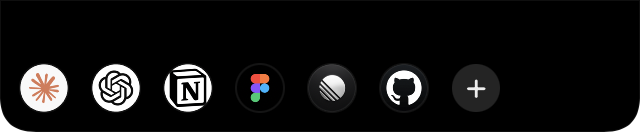
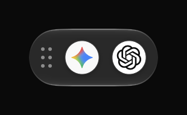

**语言：** [English](README.md) | 简体中文

<p align="center">
  
</p>

<h1 align="center">NeatWebApp</h1>

<p align="center">
  <strong>把网站变成专注的 macOS 应用，从刘海处随手启动。</strong>
</p>

<p align="center">
  <a href="https://github.com/NeatMacApps/NeatWebApp/releases/latest"></a>
  <a href="LICENSE"></a>
  
</p>

浏览器标签页一多，每天用的工具就被淹没了。Safari 的「添加到程序坞」很方便，但每存一个网页应用，程序坞就会多一个图标。

**NeatWebApp** 为你的网站提供独立的刘海启动器，窗口大部分被移出屏幕后还会自动收进通透的悬浮活动 Dock。每个应用都有独立的网站数据，可以用不同实例分开工作账号和个人账号。

<table align="center">
  <tr>
    <td align="center">
      <br>
      <sub><b>刘海启动器</b> · 鼠标悬停，常用网站随手打开</sub>
    </td>
    <td align="center">
      <br>
      <sub><b>活动 Dock</b> · 收起的网站随时弹回来</sub>
    </td>
  </tr>
</table>

## 为什么选择 NeatWebApp？

| 功能 | 它能做什么 |
| :--- | :--- |
| **刘海启动器** | 鼠标悬停在 MacBook 刘海上，或其他屏幕的顶部中央热区，就能展开网站启动器。启动器独立于系统程序坞，不需要账号或云同步。 |
| **贴边收进活动 Dock** | 把窗口拖到屏幕外大半，它会自动收进通透的悬浮活动 Dock。点图标恢复原来的窗口，右键图标可退出对应网页应用。 |
| **独立网站数据** | 每个应用实例都有持久化且相互隔离的 WebKit 数据存储，Cookie 和网站存储互不影响；页面缩放与收藏也按实例保存。 |
| **按网站隐藏元素** | 隐藏特定网站上碍眼的横幅、侧边栏或导航元素，不影响其他网页应用。 |
| **从收藏创建应用** | 右键应用内收藏，选择「添加 WebApp」。新应用使用独立数据存储，并一次性复制当前应用的 Cookie。 |
| **原生 WebKit 体验** | 简洁的 WebKit 窗口、在访达中管理下载、文件上传、摄像头与麦克风支持，以及 Sparkle 自动更新。 |

和 Safari 网页应用一样，运行中的 NeatWebApp 网站也能用自己的网站图标出现在 macOS 程序坞和 ⌘Tab 中。NeatWebApp 的差异在于独立的刘海启动器、自动贴边收纳、内置元素隐藏和从收藏创建应用；Safari 本身同样具备网站数据隔离。

## 安装

**需要 macOS 15 或更高版本，支持 Apple 芯片和 Intel。** 网站及其数据只留在这台 Mac 上；NeatWebApp 没有账号、云同步或遥测服务。

### Homebrew

```bash
brew install --cask x0c/tap/neatwebapp
```

### 直接下载

从 [Releases](https://github.com/NeatMacApps/NeatWebApp/releases/latest) 下载最新的**已签名并公证**的 `NeatWebApp-x.y.z.dmg`，把 **NeatWebApp** 拖进「应用程序」。

应用通过 [Sparkle](https://sparkle-project.org) 自动检查更新，也可以从菜单栏或「通用」设置里选择「检查更新…」。

<details>
<summary><strong>从源码构建</strong></summary>

需要 Xcode 16.2+ 和 [XcodeGen](https://github.com/yonaskolb/XcodeGen)：

```bash
git clone https://github.com/NeatMacApps/NeatWebApp.git
cd NeatWebApp
xcodegen generate
xcodebuild -project NeatWebApp.xcodeproj -scheme NeatWebApp -configuration Release \
  -destination 'platform=macOS' -derivedDataPath build/DerivedData build
rm -rf /Applications/NeatWebApp.app
ditto build/DerivedData/Build/Products/Release/NeatWebApp.app /Applications/NeatWebApp.app
open /Applications/NeatWebApp.app
```

</details>

## 快速上手

1. **打开启动器：** 把鼠标移到 MacBook 刘海上；无刘海屏幕则移到顶部中央热区。
2. **添加网站：** 点启动器里的 **+**，在「网页应用」中填写名称和网址。
3. **收起与恢复：** 把窗口拖到屏幕外大半，收进活动 Dock。点图标恢复原来的窗口，右键图标可退出对应网页应用。
4. **创建独立实例：** 从窗口的「更多操作」菜单打开「收藏夹」。右键收藏并选择「添加 WebApp」，用当前 Cookie 的副本创建另一个应用。

从收藏创建应用只复制 Cookie，不复制 localStorage、IndexedDB 或通行密钥。之后两个应用的数据各自独立，部分网站仍可能要求重新登录。

## 更多原生 macOS 与开发者工具

| 项目 | 简介 |
| :--- | :--- |
| **[NeatEditor](https://github.com/NeatMacApps/NeatEditor)** | 启动迅速、专注写作的原生纯文本编辑器，支持多标签自动保存。 |
| **[NeatPaste](https://github.com/NeatMacApps/NeatPaste)** | 本地优先的菜单栏剪贴板历史，一个快捷键即可唤出。 |
| **[HandySwitch](https://github.com/x0c/HandySwitch)** 与 **[MacResourceMonitor](https://github.com/x0c/MacResourceMonitor)** | 常用菜单栏开关，以及一键查看 CPU 进程占用。 |
| **[Corral](https://github.com/corral-dev/corral-apple)** | 并排运行 Claude Code、Codex 和 Cursor，并提供原生 Mac 与 iPhone 客户端。 |

## 许可证

[MIT](LICENSE)
